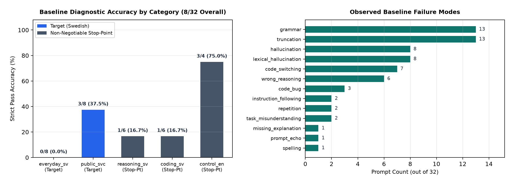

# Weight-Space Programming for SE.LLMA — Research Note

**Status:** Final (All 6 Arms Complete) · **Model:** `Qwen/Qwen2.5-0.5B-Instruct` (`bfloat16`, CPU, `seed=42`) · **Updated:** `2026-11-19 21:57 UTC` · *(Full details in [`report/report.pdf`](report.pdf))*

## 1. Critical Evaluation of *Sparks of Weight-Space Programming*
- **Strongest evidence:** The MIT team explores letting an LLM interpret and rewrite another model's weights from a text prompt—predicting which minigame a network plays (`GPT-6 Astra`) or fixing a repetition loop (`Qwen3.5-0.8B`). If improved, this could be an interesting new direction for AI.
- **Critical opinion:**
    1. **Frontier-model dependence & costs:** My first doubt whenever a study discovers a new capability with frontier models is whether it applies to LLMs in general or only the largest proprietary ones. They use `GPT-6 Astra`, and `eomcaleb/weight-space-bench` answers my two main concerns—costs and cross-model applicability: it requires private, subsidized, expensive frontier models (**19k–55k output tokens**, ~`$19` across 6 models for tiny MinAtar nets), as smaller/other LLMs perform poorly (`GPT-6 Astra` `96.3`, `GPT-6.1 Sol` `86.5` vs. `Claude Sonnet 5.5` `23.2`, `DeepSeek V4.1 Flash` `0.7`; echoed by `WeightBench` `arXiv:2611.18553`).
    2. **Technical approach ("intelligent optimizer"):** They send a prompt plus a list of numbers (weights) and ask the LLM to interpret and edit those numbers to satisfy the prompt—whether fixing a known bug or answering any random request. While the intent is an **intelligent optimizer** (**1.** understand the user request, **2.** understand the network, **3.** optimize the weights), most gains come from multi-turn trial-and-error against evaluation feedback rather than one-shot weight understanding.
    3. **Data-flow critique (the text-tokenization detour):** Converting float weights into a text string and passing it through an LLM tokenizer risks fragmenting numbers around dots, commas, punctuation, or text before mapping tokens back to embeddings and attention. For a conditioned optimization of floats, it makes far more sense to design a **selective optimizer** that sees weights directly as numbers and targets them via conditioning and attention—while avoiding SE.LLMA's sovereignty risk of relying on private foreign APIs instead of gradient methods (`AdamW`, `Muon`, `LoRA`).
- **Awake Mapping Analogy:** This study reminded me of neurosurgeon **Dr. Jesús Martín-Fernández** (`2022`, `2025`), who operates on brain tumors in awake patients. Like neuroplasticity in a brain, modifying or fine-tuning weights rewires paths for new tasks at the risk of losing previous abilities. He first sets constraints (abilities to keep) and maps the brain with small electrical perturbations (DES, *connectome-stop points*). Analogously, before optimizing an LLM, I first define tests for abilities I do not want to lose, and only then optimize (probing layers, using an "intelligent optimizer", or applying gradients/`LoRA`).

## 2. Playground (`notebooks/01_explore_models_cpu.py`)
With limited local resources (`AMD Ryzen 7 5800U` CPU, `6.7 GiB` RAM, no GPU, 4-hour budget), I built a playground in `notebooks/01_explore_models_cpu.py` to screen small open models on Swedish and chose **`Qwen/Qwen2.5-0.5B-Instruct`** (`bfloat16`, `1.84 GB` RAM, `5.08 tok/s`), though the same workflow applies to the other candidates (`SmolLM2-360M/135M`, `gpt-sw3-126m`). With more compute, I would have replicated WSP on a medium-sized model for Swedish comparing WSP, gradient methods, `QLoRA`, and a small trained attention-based selective optimizer; under my constraints, I proposed the smaller study below with a Gemini AI agent.

## 3. Hypothesis
Using `Qwen/Qwen2.5-0.5B-Instruct`, I test three practical questions:
- **H1 (Can static weight inspection find the "Swedish weights"?):** Inspecting weight matrices without running prompts will **not** accurately locate the layers that control Swedish during active inference (*awake probing*).
- **H2 (Can small, gradient-free edits fix Swedish safely?):** Scaling targeted weights without gradient training—chosen statically or via awake probing—will **not** beat random weight edits on held-out Swedish without risking protected skills (*stop-points*: English, coding, reasoning).
- **H3 (Do standard methods work better?):** Prompting or lightweight gradient training (`Micro-LoRA`) will offer a cleaner trade-off than manual weight edits.
- *What would prove me wrong:* Strong correlation (`r ≥ 0.6`) between static inspection and awake probing, plus held-out Swedish NLL gains beating random edits, prompting, and `Micro-LoRA` with zero stop-point harm.

## 4. Experimental Design & What Each Test Did
- **Dataset (`data/swedish_test_suite.json`) & NLL Metric:** `32` prompts proposed and graded with **Gemini Hydrogen** (plus automated Python unit tests/regex, verified by me), split into `12 dev` (probing, calibration, LoRA training) and `20 eval` (held-out exam): `16` Swedish targets (`everyday_sv`, `public_services_sv`) and `16` stop-points (`reasoning_sv`, `coding_sv`, `control_en`). Across all 6 tests I measure teacher-forced **Negative Log-Likelihood (`NLL = -log p`)** and **Perplexity (`PPL = exp(NLL)`)** on the gold reference answers (**lower = higher probability assigned to the right answer**).
- **The 6 Tests (`src/wsp_experiment.py`):**
  1. **Unchanged Baseline:** `Qwen2.5-0.5B-Instruct` untouched on `eval`.
  2. **Static Weight Edit (WSP):** Data-free `lm_head` Swedish−English vector → top-`256` aligned `mlp.down_proj` columns (`229,376` weights) scaled by `+15%` (`1.15×`).
  3. **Awake DES Edit:** Perturb each of the `24` layers (`0.85×`) on a 6-prompt `dev` probe to pick the `4` most selective Swedish layers (`[1, 22, 16, 19]`), pick `256` columns aligned to `dev` activations, and scale by `+5%` (`α = 0.05`, calibrated so `ΔEN_dev ≤ 0.05`).
  4. **Random Edit (3 seeds):** Scale `256` random columns by `+15%` across seeds `42, 123, 999`.
  5. **Prompting Control:** Strict Swedish system prompt with zero weight edits.
  6. **Micro-LoRA:** Frozen base + trainable `LoRA` (`r=4`, `layers 18..23`, `138,240` params) trained for `18` `AdamW` steps on the `12 dev` items.

## 5. Results
- **CPU Screening (`results/cpu_prompt_benchmark.json`):** Tested small models on the same Swedish prompt to choose one for the main experiment:
  - **`Qwen/Qwen2.5-0.5B-Instruct` *(selected)*:** `5.08 tok/s`, `1842.4 MB` peak RAM. Readable Swedish with clear, fixable issues (agreement error *"ett tekniskt utvecklade system"* and English code-switching *"Siri, Apple's smart home assistant"*).
  - **`HuggingFaceTB/SmolLM2-360M-Instruct`:** `6.46 tok/s`, `1565.3 MB` peak RAM. Echoed the prompt and collapsed into broken pseudo-Swedish (*"1. **Södra- och längd-själ"*).
  - *Other configured candidates (`notebooks/01_explore_models_cpu.py`):* `SmolLM2-135M-Instruct`, `AI-Sweden-Models/gpt-sw3-126m` (not run once `Qwen` passed and `SmolLM2-360M` failed).
- **32-Prompt Baseline (`Qwen2.5-0.5B-Instruct`, graded with Gemini Hydrogen + automated checks):** Passed **8/32 (25.0%)** overall: fluent English (`3/4`) and context-grounded Swedish reading comprehension (`3/3`), but `0/8` on everyday Swedish and `0/5` on Swedish public-service facts from memory (`3/8` in `public_services_sv`) due to grammar (`13`), truncation (`13`), invented words (`8`), and English code-switching (`7`), plus `1/6` on Swedish reasoning and `1/6` on Python coding.

- **Static vs. Awake Layer Probing:** Near-zero correlation across the 24 layers (Pearson `r = -0.0747`, Spearman `ρ = -0.1527`; Awake DES top-4 layers: `[1, 22, 16, 19]`).
- **6-Arm Held-Out Comparison (`eval`):** *(Lower `NLL`/`PPL` = higher probability for the reference answer; `Δ` = change vs. Baseline.)*

| Arm | SV Target NLL (Δ) | SV PPL | Non-Neg NLL | EN Stop NLL (Δ) | Params (L2) | CPU (s) |
| :--- | :---: | :---: | :---: | :---: | :---: | :---: |
| 1. Unchanged Baseline | 2.6328 (+0.000) | 13.91 | 0.8383 | 0.8507 (+0.000) | 0 (0.00) | 130.93 |
| 2. Static Weight Edit (WSP) | 2.6334 (+0.001) | 13.92 | 0.8425 | 0.8513 (+0.001) | 229,376 (1.23) | 83.78 |
| 3. Awake DES Edit | 2.6353 (+0.003) | 13.95 | 0.8420 | 0.8397 (-0.011) | 229,376 (0.43) | 821.08 |
| 4. Random / Untargeted Edit (3 seeds) | 2.6365 ± 0.0013 (+0.004) | 13.96 | 0.8431 | 0.8661 ± 0.0120 (+0.015) | 229,376 (1.31) | 233.59 |
| 5a. Prompting / Inference Control | 2.6345 (+0.002) | 13.94 | 0.8513 | 0.8507 (+0.000) | 0 (0.00) | 89.41 |
| 5b. Micro-LoRA (layers 18..23, r=4) | 2.7075 (+0.075) | 14.99 | 0.8466 | 0.9020 (+0.051) | 138,240 (0.96) | 4115.96 |

## 6. Interpretation, Limitations & Recommendation
- **Why manual weight edits and prompting barely changed anything (`H1` & `H2` confirmed):** Static inspection failed to locate the layers that affect Swedish (`r = -0.0747`). `Static WSP` (`Δ=+0.001`), `Awake DES` (`Δ=+0.003`), and `Prompting` (`Δ=+0.002`) stayed virtually identical to the untouched baseline (`2.6328`) and no better than touching `256` random columns (`Random`: `Δ=+0.004 ± 0.0013`). Scaling `256` columns without gradients cannot add missing Swedish fluency—though `Awake DES` stop-point calibration (`α = 0.05`) protected English (`ΔEN=-0.011` vs. Random `+0.015`).
- **Why `Micro-LoRA` got worse on average (`+0.075` SV, `+0.051` EN) yet improved `4/4` Python tests:** Training `18` steps on only **`12` `dev` examples** overfit those 12 answers, hurting unseen open-ended Swedish (`ev_eval_03` `+0.1906`, `pub_eval_02` `+0.1519`). Yet it improved **all 4/4** held-out Swedish Python tasks (`Δ=-0.056`: `-0.0841`, `-0.0463`, `-0.0087`, `-0.0864`), showing the divide between ***unbricking*** an existing skill (Python formatting) and **learning a missing language**.
- **Limitations:** Laptop CPU budget (`~91 min` for the 6-arm `--nll-only` run), `0.5B` model scale, `32`-prompt suite (`12 dev` / `20 eval`), teacher-forced `NLL`, and linear column scaling on `mlp.down_proj`.
- **My recommendation for SE.LLMA:** **Do not pursue LLM-driven or data-free static weight-space programming** to train or fix Swedish models—it is costly, threatens sovereignty, failed to locate the right layers (`r = -0.0747`), and gave zero gain over random edits. Focus instead on sovereign continued pretraining and gradient fine-tuning (`AdamW`, `Muon`, `LoRA`) paired with **awake stop-point test suites**. *Next experiment with more compute:* Use awake stop-point probing on a `7B–14B` Swedish checkpoint to guide layer-selective `LoRA` (or test a small dedicated attention-based optimizer acting directly on numeric weights).

## 7. Reproducibility & AI Usage
- **Reproduce:** `uv sync && uv run python -m src.wsp_experiment --nll-only && uv run python -m src.report_builder`
- **AI Usage:** I used **Gemini Hydrogen** to propose the 32 prompts (`data/swedish_test_suite.json`), draft reference answers, evaluate baseline outputs (`results/qwen_baseline_eval.json`, alongside automated Python tests/regex), synthesize replication benchmarks, and scaffold the `marimo` notebooks and `src/` modules; all controls, runs, and numbers were verified by me.
- **Key References:** Takehi et al. (*Sparks of Weight-Space Programming*); `eomcaleb/weight-space-bench`; Marasini et al. (`WeightBench`, `arXiv:2611.18553`); Martín-Fernández et al. (`2022` PMID `35624947`, `2025` PMID `40110086`).
