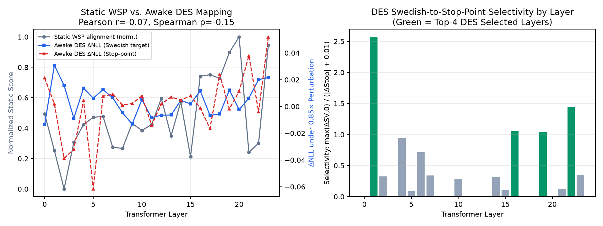
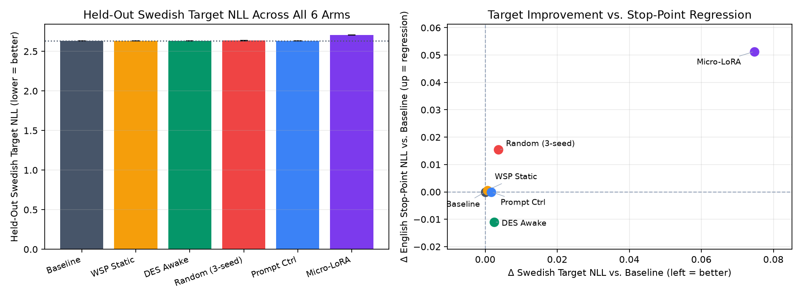

# Weight-Space Programming for SE.LLMA — Research Note

**Status:** Final (All 6 Arms Complete) · **Model:** `Qwen/Qwen2.5-0.5B-Instruct` (`bfloat16`, CPU, `seed=42`) · **Updated:** `2026-11-19 21:49 UTC`

## 1. Critical Evaluation of *Sparks of Weight-Space Programming*
- **Strongest evidence:** The MIT team explores a new paradigm: letting an LLM interpret and rewrite the weights of another model based on a user's text input. In the cases shown in their blog, they first test whether a frontier LLM (`GPT-6 Astra`) can "understand" the parameters of a model trained to play a minigame (predicting which game it is), and whether it can fix issues in another LLM suffering from a repetition loop (such as `Qwen3.5-0.8B`). These test cases are intriguing, and if the idea and methods are further improved, this could become an interesting new direction for AI.
- **Critical opinion:**
    1. **Frontier-model dependence & resource costs:** My first doubt whenever a study discovers a new functionality using the newest frontier models is whether it is applicable to LLM technology in general, or just limited to the newest and largest models. In their blog, they use `GPT-6 Astra`—one of the latest LLMs to date—but luckily a follow-up study by `eomcaleb` (`eomcaleb/weight-space-bench`) answers two of my main concerns: the costs and the applicability to other models. And it seems that if you want to use this new approach, you need to use frontier models—which are the most expensive to run, private, subsidized, and consume heavy resources (**19k–55k output tokens**, ~`$19` across 6 models just for tiny MinAtar networks)—since smaller or alternative LLMs do not perform that well (`GPT-6 Astra` `96.3` and `GPT-6.1 Sol` `86.5` vs. `Claude Sonnet 5.5` `23.2` and `DeepSeek V4.1 Flash` `0.7`; echoed by `WeightBench` `arXiv:2611.18553`).
    2. **Technical approach (the LLM as an "intelligent optimizer"):** From a technical approach, I can summarize what this study is doing as sending a request to an LLM with a list of numbers—the weights of a model—asking the LLM to understand that list of numbers with respect to the request, and in a next step modifying those numbers in the target model to improve a specific behavior requested in the prompt. Basically, they can pass the same list of weights and ask the LLM to fix a known issue by changing the weights, just as they could ask for any random request—and the LLM will still give an answer. Although the authors' intent can be summarized as building an **intelligent optimizer**—since they want to **(1)** understand the user request, **(2)** understand the network, and **(3)** optimize the weights to fulfill the user's request—in practice most gains rely on multi-turn trial-and-error against evaluation feedback rather than one-shot weight understanding.
    3. **Data-flow critique (the text-tokenization detour):** Following the flow of the data in practice, users start with floating-point numbers that are the weights of a network they want to optimize, convert those numbers into a text string, and pass that string through the tokenizer of the LLM—where the numbers in the string can easily be misunderstood. What if there are dots, commas, other punctuation, or text in between? Will the tokenizer conserve the intended numbers? Then from token IDs it goes back to vector embeddings, attention, and neural network layers. Many steps of this expensive process could be simplified considering that the goal is a conditioned optimization of floating-point numbers: it makes more sense to design a selective optimizer that skips the first steps, sees all the weights in their original numerical form, and through a conditioning input and attention mechanisms targets specific weights—while also avoiding SE.LLMA's sovereignty risk of depending on private foreign frontier APIs instead of sovereign gradient methods (`AdamW`, `Muon`, `LoRA`).
- **Awake Mapping Analogy:** This study of modifying weights in a neural network reminded me of neurosurgeon **Dr. Jesús Martín-Fernández** (`2022`, `2025`), who operates on brain tumors in awake patients. With the neural network as a brain, one can think that during training—where neurons establish their connections and learn—there is neuroplasticity as in a real brain: when modifying weights and allowing for fine-tuning, internal paths can be rewired so other neurons take charge of new tasks, at the risk of losing previous abilities. This neurosurgeon first establishes explicit constraints—abilities that must be kept—and maps the brain with small localized perturbations (Direct Electrical Stimulation, DES) to test how they affect the patient's abilities (*connectome-stop points*). In this analogy, when fine-tuning or optimizing a neural network, I first establish tests for the LLM abilities that I do not want to modify (or want affected the least), and only later start the optimization—whether testing different layers, using an "intelligent optimizer", or applying gradient-based optimizers and `LoRA`.

## 2. Playground (`notebooks/01_explore_models_cpu.py`)
With limited local hardware resources (`AMD Ryzen 7 5800U` CPU, `6.7 GiB` RAM, no GPU) and a 4-hour budget, I had to choose a small language model that could run and be modified locally. In `notebooks/01_explore_models_cpu.py` (`results/cpu_prompt_benchmark.json`), I built a playground to screen small candidate models on a Swedish prompt while tracking RAM, CPU usage, and throughput. I chose **`Qwen/Qwen2.5-0.5B-Instruct`** (`bfloat16`, `1842.4 MB` peak RSS, `5.08 tok/s`) because it runs comfortably within memory and already produces understandable Swedish, yet shows clear, concrete flaws to fix—such as grammar/agreement errors (*"ett tekniskt utvecklade system"*) and mid-sentence English code-switching (*"Siri, Apple's smart home assistant"*). That said, I could also have used the same workflow to try fixing the Swedish issues on the other candidate models included in the notebook (`HuggingFaceTB/SmolLM2-360M-Instruct`, `HuggingFaceTB/SmolLM2-135M-Instruct`, or `AI-Sweden-Models/gpt-sw3-126m`).

- **Experiments out of reach under local constraints:** Following the arguments in Section 1, if I had more time and resources, I would have liked to replicate the Weight-Space Programming (WSP) tests on a medium-sized language model applied directly to Swedish—comparing WSP (directly analyzing and modifying a model like `Qwen`), gradient methods, `QLoRA`, and a small trained "intelligent optimizer" able to use attention mechanisms and conditioned on a text input. Due to the hardware and time constraints, I proposed a smaller study with a Gemini AI agent, presented next.

## 3. Hypothesis
Using `Qwen/Qwen2.5-0.5B-Instruct` as my testbed, I want to answer three simple, practical questions before trusting weight-space editing for SE.LLMA:
- **H1 (Can static weight inspection find the "Swedish weights"?):** Looking at weight matrices without running the model (*static inspection*) will **not** accurately locate which layers actually control Swedish behavior when tested during active inference (*awake probing*).
- **H2 (Can small, gradient-free edits fix Swedish without breaking other skills?):** Scaling a targeted subset of weights without gradient training—whether chosen statically or via awake probing—will **not** meaningfully improve held-out Swedish over simply scaling random weights, or it will risk hurting protected abilities (*stop-points* like English, coding, and reasoning).
- **H3 (Do standard methods work better?):** Keeping the weights frozen with better prompting, or adapting them with standard gradient training (`Micro-LoRA`), will offer a cleaner and safer trade-off than manual weight edits.
- *What would prove me wrong:* If static weight inspection cleanly matches awake layer probing (`r ≥ 0.6`) and gradient-free edits measurably improve held-out Swedish over random edits, prompting, and `Micro-LoRA` with zero harm to English or reasoning.

## 4. Experimental Design & What Each Test Did
- **Dataset split (`data/swedish_test_suite.json`):** `32` prompts proposed with **Gemini Hydrogen** and reviewed by me, split into `12 dev` (used for probing, calibration, and `Micro-LoRA` training) and `20 eval` (a held-out final exam). Half target Swedish (`everyday_sv`, `public_services_sv`) and half guard protected stop-points (`reasoning_sv`, `coding_sv`, `control_en`). Baseline generations (`results/qwen_baseline_responses.json`) were evaluated with **Gemini Hydrogen** alongside automated Python subprocess tests and regex checks (`results/qwen_baseline_eval.json`).
- **Evaluation metric (what NLL means):** To compare all 6 tests deterministically on CPU, I measure **Negative Log-Likelihood (`NLL`)**—the standard language-model cross-entropy loss (`-log p`) evaluated directly over the tokens of the gold reference answer—together with **Perplexity (`PPL = exp(NLL)`)**. Intuitively, **lower `NLL`/`PPL` is better**: it means the model assigns higher probability to the correct Swedish or English answer; positive `Δ` vs. Baseline means the model got worse (more surprised by the right answer).
- **The 6 Tests (`src/wsp_experiment.py`):**
  1. **Unchanged Baseline:** Evaluate `Qwen2.5-0.5B-Instruct` untouched on `eval` to get the reference NLL scores.
  2. **Static Weight Edit (WSP — zero forward passes):** Build a "Swedish minus English" vector solely from the vocabulary matrix (`lm_head`: `å, ä, ö` tokens and 36 Swedish vs. 30 English function words), find the top-`256` most aligned `mlp.down_proj` columns (`229,376` weights), and scale them by `+15%` (`1.15×`) without running any prompts.
  3. **Awake DES Edit:** Run a 6-prompt `dev` subset (`3` Swedish + `3` stop-points) while scaling each of the `24` layers down (`0.85×`) one by one to find the `4` layers (`[1, 22, 16, 19]`) most selective for Swedish over stop-points; pick the top-`256` columns aligned to `dev` activations and scale by `+5%` (`α = 0.05`), calibrated so English on `dev` stays safe (`ΔEN_dev ≤ 0.05`).
  4. **Random Edit (noise control, 3 seeds):** Pick `256` columns uniformly at random across all 24 layers (seeds `42, 123, 999`) and scale by `+15%` (`1.15×`) to test whether targeted edits beat random changes of the same size.
  5. **Prompting Control (no weight edits):** Leave weights untouched and prepend a strict Swedish system prompt asking for pure idiomatic Swedish and concise Python code.
  6. **Micro-LoRA (gradient baseline):** Freeze the base weights, attach `LoRA` adapters (`r=4`, `138,240` trainable params) to `layers 18..23`, and train with `AdamW` for `18` steps solely on the `12 dev` items.

## 5. Results
**CPU Screening (Selecting the Test Model):** To choose which small language model to use for the experiments under CPU and RAM limits, I benchmarked candidate models on the same Swedish prompt (`results/cpu_prompt_benchmark.json`, `bfloat16`, `max_new_tokens=80`):
- **`Qwen/Qwen2.5-0.5B-Instruct` *(selected)*:** `5.08 tok/s` (`10.05s` load, `15.75s` generation), `1842.4 MB` peak RAM (`+1215.9 MB`). Produced coherent, structured Swedish while showing clear, fixable issues: grammar/agreement errors (*"ett tekniskt utvecklade system"*) and English code-switching (*"Siri, Apple's smart home assistant"*).
- **`HuggingFaceTB/SmolLM2-360M-Instruct`:** `6.46 tok/s` (`1.85s` load, `12.39s` generation), `1565.3 MB` peak RAM (`+691.0 MB`). Faster and lighter in memory, but echoed the prompt and degenerated into incoherent pseudo-Swedish (*"1. **Södra- och längd-själ"*), making it unsuitable as a baseline.
- *Other models configured in `notebooks/01_explore_models_cpu.py`:* `HuggingFaceTB/SmolLM2-135M-Instruct` and `AI-Sweden-Models/gpt-sw3-126m` were included as smaller playground candidates, but were not run once `Qwen2.5-0.5B-Instruct` already fit within RAM with coherent Swedish output while `SmolLM2-360M-Instruct` broke down.

**32-Prompt Baseline (`Qwen/Qwen2.5-0.5B-Instruct`):** Across the full diagnostic suite (evaluated with **Gemini Hydrogen** and automated Python/regex checks), the untouched model passed **8/32 (25.0%)** tasks overall: it retained fluent English (`3/4`) and answered Swedish reading-comprehension questions accurately when the facts were given in context (`3/3`), but failed completely on open-ended everyday Swedish (`0/8`) and Swedish public-service facts from memory (`0/5`, `3/8` overall in `public_services_sv`), mostly due to grammar errors (`13`), truncated answers (`13`), invented Swedish words (`8`), and slipping into English (`7`), alongside weak Swedish reasoning (`1/6`) and Python coding (`1/6`).

**Static Inspection vs. Awake Probing:** Looking at `Qwen`'s weights without running prompts pointed to completely different layers than probing the model during active inference—the two rankings showed essentially zero (slightly negative) correlation across the 24 layers (Pearson `r = -0.0747`, Spearman `ρ = -0.1527`), with awake probing selecting layers `[1, 22, 16, 19]`.

**6-Arm Held-Out Comparison (`eval`):** None of the gradient-free weight edits improved held-out Swedish over the unchanged baseline (`2.6328` NLL). Static WSP (`Δ=+0.001`) and Awake DES (`Δ=+0.003`) performed no better than editing random weights (`Δ=+0.004`), though Awake DES's stop-point calibration protected English fluency better than random edits (`ΔEN=-0.011` vs. `+0.015`). Strict prompting barely moved NLL (`Δ=+0.002`), while training `Micro-LoRA` on only `12 dev` examples overfit ungrounded Swedish (`Δ=+0.075`, `ΔEN=+0.051`) yet improved **4/4** held-out Swedish Python tasks (`Δ=-0.056`). *(In the table below, lower `NLL`/`PPL` means higher probability for the gold reference answer, and `Δ` is the change vs. Baseline.)*

| Arm | SV Target NLL (Δ) | SV PPL | Non-Neg NLL | EN Stop NLL (Δ) | Params (L2) | CPU (s) |
| :--- | :---: | :---: | :---: | :---: | :---: | :---: |
| 1. Unchanged Baseline | 2.6328 (+0.000) | 13.91 | 0.8383 | 0.8507 (+0.000) | 0 (0.00) | 130.93 |
| 2. Static Weight Edit (WSP) | 2.6334 (+0.001) | 13.92 | 0.8425 | 0.8513 (+0.001) | 229,376 (1.23) | 83.78 |
| 3. Awake DES Edit | 2.6353 (+0.003) | 13.95 | 0.8420 | 0.8397 (-0.011) | 229,376 (0.43) | 821.08 |
| 4. Random / Untargeted Edit (3 seeds) | 2.6365 ± 0.0013 (+0.004) | 13.96 | 0.8431 | 0.8661 ± 0.0120 (+0.015) | 229,376 (1.31) | 233.59 |
| 5a. Prompting / Inference Control | 2.6345 (+0.002) | 13.94 | 0.8513 | 0.8507 (+0.000) | 0 (0.00) | 89.41 |
| 5b. Micro-LoRA (layers 18..23, r=4) | 2.7075 (+0.075) | 14.99 | 0.8466 | 0.9020 (+0.051) | 138,240 (0.96) | 4115.96 |

## 6. Interpretation, Limitations & Recommendation
- **Why manual weight edits and prompting barely changed anything (`H1` & `H2` confirmed):** First, inspecting weights without running prompts failed to locate the layers that actually affect Swedish during execution (`r = -0.0747`). Second, `Static WSP` (`Δ=+0.001`), `Awake DES` (`Δ=+0.003`), and `Prompting` (`Δ=+0.002`) remained virtually identical to the untouched baseline (`2.6328`) and no better than touching `256` random columns (`Random`: `Δ=+0.004 ± 0.0013`). Scaling a handful of columns without gradients cannot add missing Swedish fluency—the only subtle benefit of `Awake DES` was that its stop-point calibration (`α = 0.05`) avoided hurting English (`ΔEN=-0.011`) compared to random noise (`ΔEN=+0.015`).
- **Why `Micro-LoRA` moved much more—and got worse on average (`+0.075` SV, `+0.051` EN) yet improved `4/4` Python tests:** Training `Micro-LoRA` for `18` steps (`grad_accum=4`, ~6 passes) on only **`12` `dev` examples** caused **overfitting** to those specific 12 answers, which worsened generalization on unseen open-ended Swedish prompts (e.g., `ev_eval_03` `+0.1906`, `pub_eval_02` `+0.1519`). However, on the 4 held-out Swedish Python coding tasks (`coding_sv`), `Micro-LoRA` improved **all 4/4** items (`Δ=-0.056`: `-0.0841`, `-0.0463`, `-0.0087`, `-0.0864`). This clearly illustrates the difference between ***unbricking*** (the model already knew Python, and 12 examples were enough to fix its output formatting so it stopped appending extra tests and truncating) and **learning a missing language** (12 examples cannot teach new Swedish vocabulary or facts to a `0.5B` model; they only overfit it).
- **Limitations of my setup:** Because I ran everything on a laptop CPU (`6.7 GiB` RAM, no GPU) within a 4-hour window (`~91 min` for the 6-arm `--nll-only` run), I had to use a small `0.5B` model (`Qwen2.5-0.5B-Instruct`), a `32`-prompt suite (`12 dev` / `20 eval`), and teacher-forced `NLL` rather than full text generation across all arms. With only `12` training examples, `Micro-LoRA` inevitably overfit open-ended Swedish, and my manual edits only tested scaling `256` `mlp.down_proj` columns.
- **My recommendation for SE.LLMA:** **I do not recommend pursuing LLM-driven or data-free static weight-space programming** to train or fix Swedish models. Passing weights as text strings to proprietary frontier LLMs is expensive, conflicts with SE.LLMA's technological sovereignty, and in my tests static weight inspection failed to locate the right layers (`r = -0.0747`) while manual edits gave zero gain over touching random weights. Instead, SE.LLMA should rely on sovereign continued pretraining and gradient-based fine-tuning (`AdamW`, `Muon`, `LoRA`), combined with **awake stop-point test suites** to make sure optimizing for Swedish does not break existing skills. *What I would try next with more compute:* Use awake layer probing with stop-point constraints on a `7B–14B` Swedish checkpoint to guide layer-selective `LoRA` (or test a small dedicated selective optimizer that acts directly on numeric weights via attention without text tokenization).

## 7. Reproducibility & AI Usage
- **Reproduce:** `uv sync && uv run python -m src.wsp_experiment --nll-only && uv run python -m src.report_builder`
- **AI Usage:** I used **Gemini Hydrogen** to propose the 32 diagnostic prompts (`data/swedish_test_suite.json`), draft reference answers, evaluate the baseline responses (`results/qwen_baseline_eval.json`, combined with automated Python unit tests and regex checks), synthesize replication benchmarks, and scaffold the `marimo` notebooks and `src/` modules; all experimental controls, code runs, prompt evaluations, and numbers were verified by me.
- **Key References:** Takehi et al. (*Sparks of Weight-Space Programming*); `eomcaleb/weight-space-bench`; Marasini et al. (`WeightBench`, `arXiv:2611.18553`); Martín-Fernández et al. (`2022` PMID `35624947`, `2025` PMID `40110086`).
